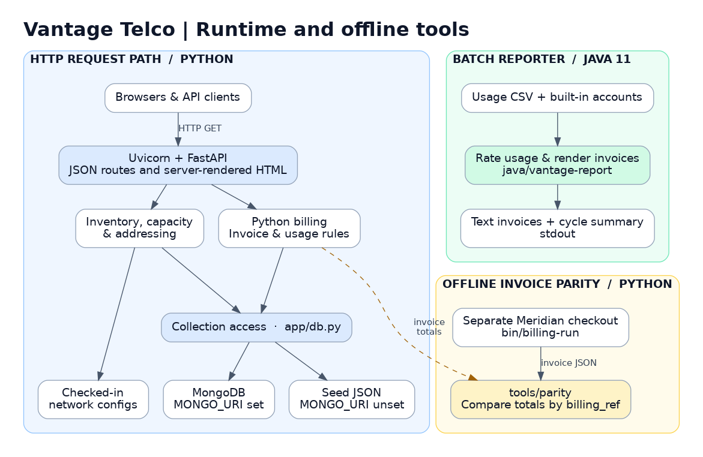

# Vantage Telco architecture

Vantage has one Python/FastAPI process for the read-only inventory, management
addressing, capacity and billing endpoints. Its HTML pages run in the same
process as its JSON API. The Java invoice reporter and the Meridian comparison
are separate commands, not services that FastAPI calls.



[SVG](diagrams/architecture.svg) · [Editable Graphviz source](diagrams/architecture.dot)

## HTTP service

Uvicorn serves [`app.main:app`](../app/main.py), which mounts five routers.

| Router | Entry points | What it does |
| --- | --- | --- |
| [Inventory](../app/routers/inventory.py) | `/resources`, `/resources/{device_uuid}`, `/circuits` | Returns sites with capacity totals and utilization. Filters sites by market or lifecycle state; circuit roll-ups count only active primary circuits. |
| [Capacity](../app/routers/capacity.py) | `/capacity`, `/capacity/locations`, `/capacity/locations/{location_code}` | Shows sales engineers which locations can meet a requested bandwidth. The same location rules serve the HTML page and JSON endpoints. |
| [Network](../app/routers/network.py) | `/network/addressing`, `/network/devices`, `/network/references?address=…` | Lists device management IPs and checks references in checked-in address plan, routing, firewall, DNS and monitoring files. It does not push device configuration. |
| [Billing](../app/routers/billing.py) | `/billing/invoices`, `/billing/usage-summary` | Calculates invoices on request and summarizes mediated, billed and unbilled usage. |
| [Dashboard](../app/routers/dashboard.py) | `/dashboard`, `/dashboard/billing` | Renders HTML directly from the same inventory and billing functions. The invoice register filters by period, account ID and billing reference. |

The main app exposes `/health` as a liveness response without checking the
database. FastAPI also provides interactive API docs at `/docs`.

### Storage and rules

- [`app/db.py`](../app/db.py) is the collection boundary. With `MONGO_URI`
  unset, it caches read-only collections loaded from [`data/seed/`](../data/seed/).
  With `MONGO_URI` set, it reads collections with the same names in MongoDB
  (`MONGO_DB`, default `vantage`): `sites`, `circuits`, `locations`, `devices`,
  `accounts` and `usage`. MongoDB must already contain the data; the app
  does not import the JSON fixtures into it.
- [Inventory rules](../app/inventory/) calculate availability as
  `max(total − allocated − maintenance buffer, 0)`. A location is serviceable
  when the result meets or exceeds the requested bandwidth. Resources are keyed
  by `device_uuid` and grouped by `market_id`.
- [Management addressing](../app/network/addressing.py) reads `devices` through
  the collection boundary and scans [local config files](../app/network/configs/)
  in both storage modes. It tracks the `10.20.0.0/16` management supernet,
  `10.20.250.0/24` growth pool and external-BGP devices, which are not
  candidates for renumbering.
- [Python billing](../app/billing/invoices.py) builds one invoice per usage
  record with a known billing account. It applies calendar-day plan proration,
  multi-line discounts, exact-MB overage at $0.012/MB, late fees, suspension
  credits and promo credits to determine the subtotal. GST/HST and applicable
  PST/QST use the subtotal before the loyalty discount. The code uses
  `Decimal`, rounds the overage charge to cents before it enters the subtotal,
  and rounds monetary values for output. Usage without a billing account is
  reported separately, not invoiced.

## Java batch reporter

[`java/vantage-report`](../java/vantage-report/) is a standalone Java 11
Maven module. [`Main`](../java/vantage-report/src/main/java/net/vantage/report/Main.java)
reads the bundled sample usage CSV or a path passed on the command line, and
loads a small account set compiled into the module. It does not read MongoDB,
call FastAPI or load Vantage's JSON account fixtures at runtime.

The Java engine aggregates usage by known account and rates it with fixed plan
fees, exact-MB overage, an account-level tax rate and a loyalty credit
calculated on the post-tax amount. This is not the same rule set as Python's
Canadian invoice engine. The batch runner renders invoices concurrently on a
fixed thread pool and prints the results in input order, followed by a cycle
summary. The renderer can also format per-charge CSV, but the CLI only prints
plain text to stdout.

## Meridian fixtures and parity

These tools run offline, outside the request path:

1. The [fixture generator](../tools/fixtures/generate_fixtures.py) writes
   Vantage's billing JSON and Meridian's account files and usage CSV from a
   shared deterministic dataset. The systems use different account IDs for the
   same customer and share a stable `billing_ref`.
2. The [parity script](../tools/parity/parity.py) builds and invokes Meridian's
   `bin/billing-run --period … --json` in a separate Meridian checkout, and
   imports Python's invoice functions directly. Neither web app nor the Java
   reporter is involved. With `MONGO_URI` unset, the Vantage side uses its seed
   JSON.
3. The script joins invoices by `billing_ref`, reports references present on
   only one side, and summarizes differences in matched totals by likely rule
   and province. A matched-total difference produces a nonzero exit status.

For local startup, tests and the side-by-side invoice demo, see the
[README](../README.md).

## Update the diagram

After changing the [DOT source](diagrams/architecture.dot), run these commands
from the repository root with Graphviz and the DejaVu Sans font installed:

```sh
dot -Tsvg docs/diagrams/architecture.dot -o docs/diagrams/architecture.svg
dot -Tpng docs/diagrams/architecture.dot -o docs/diagrams/architecture.png
```
